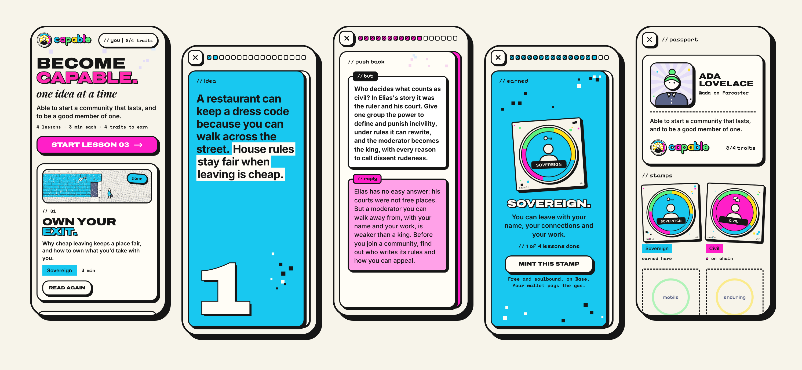
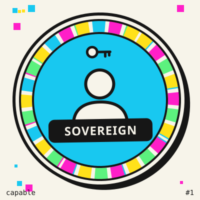
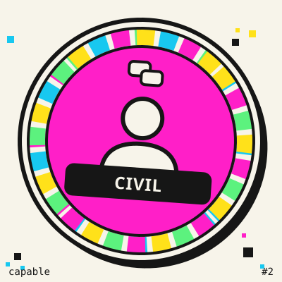
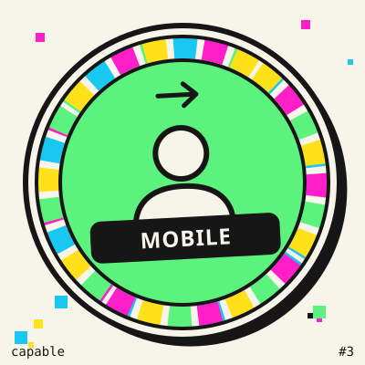
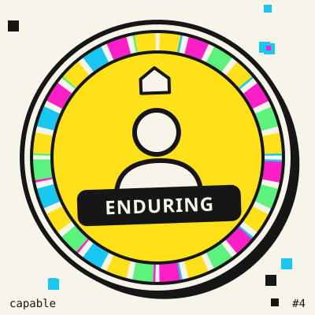

<p align="center">
  
</p>

<h3 align="center">Become capable. One idea at a time.</h3>

<p align="center">
  Short, swipeable lessons for people who want to start a community that lasts,<br>
  and to be a good member of one.
</p>

<p align="center">
  <a href="https://p-u-c.github.io/Capable/"><b>Open the app&nbsp;→</b></a>
  &nbsp;·&nbsp; free &nbsp;·&nbsp; no account needed &nbsp;·&nbsp; works offline
</p>

<p align="center">
  
</p>

---

## Three minutes, one idea

Every lesson is a deck of full-screen cards. Swipe or tap through. Each deck holds:

- **The idea**, in a few plain cards.
- **A real story**, with names, places and years you can look up.
- **One push-back card**: the strongest objection, and an honest reply.
- **Something to try this week**, with nothing to buy.
- **The best short explainers** on the idea, played inline and credited to the people who made them.

Then you earn a trait.

## Four traits make you capable

<table>
  <tr>
    <td align="center" width="25%"><br><b>Sovereign</b><br><sub>You can leave with your name, your connections and your work.</sub></td>
    <td align="center" width="25%"><br><b>Civil</b><br><sub>You can disagree with a stranger without making an enemy.</sub></td>
    <td align="center" width="25%"><br><b>Mobile</b><br><sub>You choose your communities on purpose, and let others choose theirs.</sub></td>
    <td align="center" width="25%"><br><b>Enduring</b><br><sub>You know why communities die, and what the lasting ones share.</sub></td>
  </tr>
</table>

| # | Lesson | Builds | You'll understand |
| --- | --- | --- | --- |
| 01 | **Own Your Exit** | Sovereign | Why cheap leaving keeps a place fair, and how to own what you'd take with you. |
| 02 | **Where Manners Come From** | Civil | How manners grew out of power, and why they let strangers count on each other. |
| 03 | **Vote With Your Feet** | Mobile | Why choosing where you belong is a vote, and how to make that choice on purpose. |
| 04 | **What Lasts** | Enduring | What the communes that lasted had in common, and why good intentions were not enough. |

New lessons keep arriving: when a new idea is picked up, it appears as a lesson in progress, and the best explainers slot in as they're made.

## Your passport

Everything you finish is stamped in your **passport**: a portrait drawn just for you, your traits, and your stamps.

- **Sign in with Farcaster** to put your name and face on it, or stay anonymous. Signed out, your progress lives only in your browser.
- **Mint a stamp** as a soulbound badge on Base. It's free beyond a few cents of gas, one per trait, and its art is drawn entirely on-chain. Nobody can move it, and you can burn it any time.
- **Share your passport** with one tap. Nothing is ever posted for you.

## One art grammar

The logo, the favicon, each lesson's scene, your portrait and every stamp come from one set of drawing rules. The pieces belong together, but no two are the same. The seal's ring fills in as you earn traits.

<p align="center">
  
  &nbsp;&nbsp;
  
  
  
  
</p>

Browse the generators in [`art/gallery.html`](art/gallery.html) and read the rules in [`docs/ART.md`](docs/ART.md).

## Principles

- **Plain and honest.** Every lesson argues against itself once. Every fact has a source you can check.
- **Yours.** No tracking, no ads, no server. Your progress stays in your browser unless you mint it.
- **Light.** About 225 KB to first paint. Sign-in, wallet and video code load only when you use them, everything is self-hosted, and it installs like an app.
- **Calm.** No streaks or guilt. Videos never autoplay with sound.

---

## For builders

```bash
node ingest/bin/refresh.mjs --offline           # compile content/build/app.json from lessons + seed
cd app && npm ci && npm test && npm run build   # → app/dist (static; serve it anywhere)
```

| Path | What |
| --- | --- |
| `app/` | The PWA. No framework, built with esbuild. Sign-in (`src/identity/`) and stamps (`src/stamps/`) load only when used. |
| `art/` | The generative art grammar: seal, lesson scenes, portraits, stamps. No dependencies, fully deterministic. |
| `chain/` | `CapableStamps`: an ERC-721 + ERC-5192 soulbound contract with on-chain SVG art, plus tests, a local rehearsal and the [deploy runbook](docs/DEPLOY-STAMPS.md). |
| `content/lessons/` | The lesson decks, one JSON file each. |
| `content/app.meta.json` | Name, citizen line, traits, stamp settings. |
| `ingest/` | Reads public protocol data and compiles `content/build/`. It is deterministic, cross-checks nodes, and fails closed. |
| `contract/` | The data contract, validators, the stamp-art reference and their tests. |
| `docs/` | Specs, design, readiness, reviews, runbooks. |

**How it stays current.** A GitHub Action refreshes content every 30 minutes and deploys to Pages. A scheduled editor turns new ideas into full lessons through pull requests, and CI validates each one before merging it ([docs/REFRESH.md](docs/REFRESH.md)).

**How it was built.** Several agents worked in parallel lanes against one contract, each held to its own gate (`node scripts/gate.mjs --lane <lane>`). Independent reviewers checked the content, the code and the UX, and their reviews live in [`docs/reviews/`](docs/reviews/). See [`docs/SWARM.md`](docs/SWARM.md).

**Turning on stamps.** Deploy `chain/` from your own wallet ([docs/DEPLOY-STAMPS.md](docs/DEPLOY-STAMPS.md)), put the address in `content/app.meta.json` under `stamps.address`, and push.

Code is MIT licensed. Fonts are under the SIL Open Font License. Explainers belong to their creators, who are credited in the app.
